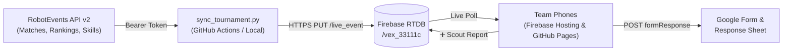

# 🤖 VEX V5RC Live Tournament Hub & Scouting App

A fast, mobile-first multi-page Progressive Web App (PWA) built for **VEX V5 Robotics Competition (2026–2027: Override)** teams. Combines **automated RobotEvents v2 API live syncing** (scores, rankings, schedules, elimination brackets, and skills) with **collaborative team scouting** and **interactive team dossiers**.

### 🌐 Live Deployments
- **Primary App (Firebase Hosting)**: **[https://vex-33111c.web.app](https://vex-33111c.web.app)**
- **GitHub Pages Mirror**: **[https://mlucodeacademy.github.io/vex-scouting-app/](https://mlucodeacademy.github.io/vex-scouting-app/)**

---

## ✨ Key Features

- **🧭 Multi-Page App Navigation**:
  - **🏠 Home Dashboard**: At-a-glance **"Next Up" Hero Banner** (station `RED 1/2` or `BLUE 1/2`, field assignment, alliance partner, opponents, and matches away), **🟢 On Field Now** tracker, **🏆 Current Rank** card, and upcoming personal matches.
  - **★ My Team**: Personal qualification & elimination schedule with live scores (`0 : 0` → `✅ Final`).
  - **📅 Schedule**: Full division schedule (Quals + Elimination brackets) with instant search and field filters (`Buffalo` / `Kirby`).
  - **🏆 Rankings**: Live division standings (`Rank`, `Team`, `W-L-T`, `WP`, `AP`, `SP`).
  - **🔭 Scout & Pick List**: Sortable scouting leaderboard combining `0–5` scout ratings (`Auton`, `Match Loading`, `Scoring`, `Toggle Mech`, `Driving`), field notes, and 2026–2027 Season Skills scores.
- **🎯 Multi-Team Switcher (Usable by Any Team)**:
  - Tap the upper-left team badge (`33111C ▾`) or tap **`★ Set as My Team`** inside any team's dossier to switch the entire app's perspective to another team.
  - Supports direct shareable URLs and QR codes per team: e.g., `https://vex-33111c.web.app/?team=1412J`.
- **🕵️ Interactive Team Intelligence Dossiers**:
  - Tap any team badge anywhere in the app to open their **Team Dossier**:
    - **2026–2027 Season Skills High** (`Driver` + `Programming` breakdown)
    - **Robot Name, School/Organization, Grade Level & City**
    - **Crowdsourced Scouting Averages & Notes**
    - **Full Event Match List & Live Scores**
- **📍 Event Venue & Info Popup**:
  - Tap the event header (`Texan Standoff ℹ️`) to view the host venue, street address, SKU (`RE-V5RC-26-5031`), field names, and 1-tap buttons for **Google Maps** and **RobotEvents**.
- **🔒 Secure Server-Side API Sync Architecture**:
  - Your RobotEvents API Bearer Token is **never** sent to client browsers.
  - `sync_tournament.py` (via GitHub Actions cron or local terminal) polls the official RobotEvents API v2 and pushes normalized match results, `Sched` / `Actual` timestamps, rankings, and live skills runs to Firebase Realtime Database.
- **📋 Dual Scouting Persistence (Firebase RTDB + Google Forms/Sheets)**:
  - Submitting a scout report in the app (`➕ Scout`) syncs immediately to all teammates' phones via Firebase RTDB **and** posts directly to your team's Google Form / Google Sheets response spreadsheet.

---

## 🏗️ Architecture



---

## ⚡ Running Live Tournament Sync (`sync_tournament.py`)

### Option A: Automated via GitHub Actions
The workflow in [`.github/workflows/sync_tournament.yml`](.github/workflows/sync_tournament.yml) runs `sync_tournament.py` automatically on tournament day (every 5 minutes) or on demand via **Actions → VEX Live Tournament Sync → Run workflow**.
- Store your RobotEvents API v2 JWT in your repo's **Settings → Secrets and variables → Actions** as `ROBOTEVENTS_TOKEN`.

### Option B: Local Game-Day Loop (Every 60 Seconds)
1. Create a `.env` file in the project root (git-ignored):
   ```ini
   ROBOTEVENTS_TOKEN=your_robotevents_jwt_token_here
   ```
2. Run a one-time sync or continuous 60-second loop:
   ```bash
   # One-time sync
   python3 sync_tournament.py

   # Continuous 60s loop during the tournament
   while true; do python3 sync_tournament.py; sleep 60; done
   ```

What `sync_tournament.py` updates automatically:
- Dynamic schedule regeneration if the Event Partner re-runs pairings after check-in
- Elimination bracket matches (`R16`, `QF`, `SF`, `F`) as soon as Alliance Selection finishes
- Official Red & Blue scores (`0 : 0` → `✅ Final`)
- `Sched` vs. `Actual` match start timestamps and current `🟢 ON FIELD` match number
- Official Division Rankings (`W-L-T`, `WP`, `AP`, `SP`)
- Live tournament Skills runs (`/events/{id}/skills`)

---

## 🚀 Deploying Updates

### 1. GitHub Pages
GitHub Pages serves the root `index.html` on the `main` branch (`https://mlucodeacademy.github.io/vex-scouting-app/`). Whenever `public/index.html` is updated, keep root `index.html` in sync:
```bash
cp public/index.html index.html
git add public/index.html index.html
git commit -m "chore: sync root index.html for GitHub Pages"
git push
```

### 2. Firebase Hosting
Firebase Hosting serves from the `public/` directory (`https://vex-33111c.web.app`):
```bash
npx -y firebase-tools@latest deploy --only hosting --project my-project-1524591195518
```

---

## 🔒 Security & Privacy

- **Zero Client Token Exposure**: `ROBOTEVENTS_TOKEN` is read exclusively from `.env` (git-ignored) or GitHub Actions Secrets (`secrets.ROBOTEVENTS_TOKEN`). It is never embedded in `index.html`.
- **Offline Resilient**: Client phones cache schedule, scores, and scouting data in `localStorage` so the app remains responsive even inside school gyms with spotty cellular reception.
